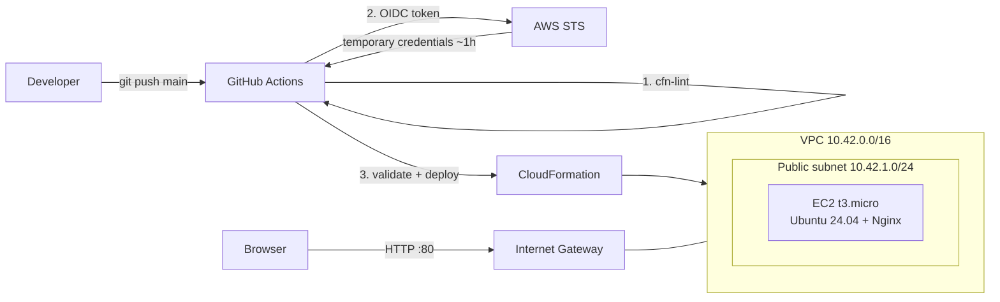

# AWS CloudFormation CI/CD with GitHub Actions and OIDC

Infrastructure as Code pipeline: every push to `main` lints, validates and deploys a CloudFormation stack (VPC + Ubuntu 24.04 + Nginx on EC2) to AWS. GitHub authenticates to AWS with **OIDC short-lived credentials**, so **no AWS access keys are stored anywhere**.


-2ea44f)


## Architecture



## What I built

- **One template, many environments.** `cloudformation.yaml` takes an `Environment` parameter. I deployed it as separate `dev` and `test` stacks from the console, each with its own isolated network.
- **Push-to-deploy pipeline.** On every push to `main`, GitHub Actions lints the template (`cfn-lint`), validates it with AWS, and runs `aws cloudformation deploy` (create or update through a change set). Pull requests are only linted, never deployed.
- **Keyless authentication.** An IAM OIDC identity provider trusts GitHub. The deploy role's trust policy allows only this repository's `main` branch, using GitHub's immutable owner and repository IDs.
- **Least-privilege IAM.** The deploy role can manage only the CloudFormation, SSM and EC2 actions this stack needs ([policy](iam/deployment-policy-lab.json)).
- **Safe updates.** Changing a tag and pushing again moved the stack to `UPDATE_COMPLETE` and kept the same EC2 instance (in-place update, no replacement).
- **Secure defaults.** IMDSv2 is enforced (`HttpTokens: required`). The security group opens only port 80, with no SSH. The AMI comes from Canonical's public SSM parameter, so no AMI ID is hard-coded per region.
- **Controlled teardown.** A manual `Destroy` workflow deletes the stack after you type its name to confirm.

## Repository structure

```text
.
├── cloudformation.yaml               # VPC, subnet, IGW, routes, SG, EC2 + Nginx (User Data)
├── .github/workflows/
│   ├── deploy.yml                    # lint -> OIDC -> validate -> deploy -> outputs
│   └── destroy.yml                   # manual, confirmed stack deletion
├── iam/
│   ├── deployment-policy-lab.json    # permissions for the deploy role
│   ├── trust-policy-new-repos-2026.json   # OIDC trust (immutable owner/repo IDs)
│   └── trust-policy-legacy-repos.json     # OIDC trust (classic owner/repo format)
└── docs/
    └── lab-notes.md                  # detailed lab notes and Q&A
```

## How to run it

**Prerequisites:** an AWS account and a fork of this repository.

1. **Create the OIDC provider** in IAM → Identity providers: URL `https://token.actions.githubusercontent.com`, audience `sts.amazonaws.com`.
2. **Create the deploy role** with a trust policy from [`iam/`](iam/) (replace the `<placeholders>`) and attach [`deployment-policy-lab.json`](iam/deployment-policy-lab.json).
3. **Add repository variables** (Settings → Secrets and variables → Actions → Variables):

   | Variable | Example |
   |---|---|
   | `AWS_ROLE_ARN` | `arn:aws:iam::123456789012:role/github-iac-deploy-role` |
   | `AWS_REGION` | `eu-central-1` |

4. **Push a change** to `cloudformation.yaml` on `main`, or run the **Deploy** workflow manually. The `WebsiteURL` output shows the address. Nginx needs a few minutes after `CREATE_COMPLETE` to finish installing.
5. **Clean up:** run the **Destroy** workflow and type `bongodev-github-iac-dev` to confirm.

To deploy from your own machine instead:

```bash
aws cloudformation deploy \
  --template-file cloudformation.yaml \
  --stack-name my-nginx-dev \
  --parameter-overrides Environment=dev \
  --region eu-central-1
```

## Screenshots

<!-- Add images to docs/screenshots/ and uncomment:


-->

## Challenges and what I learned

- **`CREATE_COMPLETE` doesn't mean the app is ready.** CloudFormation finishes when the instance exists, but User Data still installs Nginx afterwards. In a real setup I'd add a `CreationPolicy` with `cfn-signal` so the stack waits for the app.
- **User Data runs only on first boot.** Editing the HTML in the template doesn't change a running instance. A tag change, by contrast, updates in place, which is why I used it to prove the update path.
- **Region mismatch in the course material.** The instructions paired `us-west-2` with N. Virginia, but N. Virginia is `us-east-1`. I standardized on `eu-central-1`.
- **OIDC subject claims are strict.** Adding a GitHub `environment:` to the job changes the token's `sub` claim, so the trust policy must match the exact claim format.

## Possible improvements

- Wait for the app with `CreationPolicy` + `cfn-signal`
- Add a manual approval step before deploying to a `prod` stack
- Serve HTTPS through an Application Load Balancer and ACM certificate
- Rewrite the stack in Terraform with remote state in S3

## Cost and security

- A `t3.micro` is Free Tier eligible, but the instance and its public IPv4 address can still cost money. **Run Destroy when you're done.**
- No credentials are committed: `.gitignore` excludes `.env`, `*.pem`, `*.key` and `.aws/`.

---

Built during the bongoDev DevOps bootcamp, eu-central-1 (Frankfurt), 2026.
